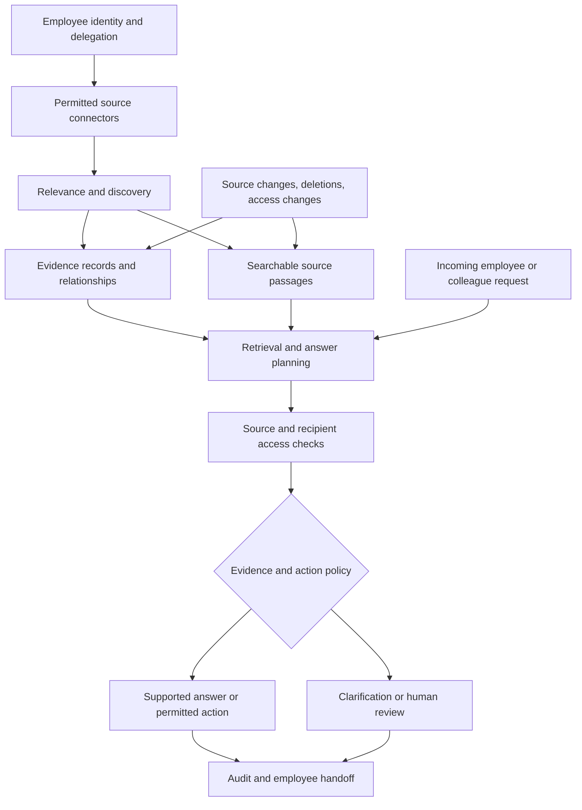

# Proposed technical architecture

**Design proposal only. No live AI Peer backend or integration is implemented.**
The current film is authored animation with illustrative data. See
[implementation status](implementation-status.md) for the evidence boundary.

## Logical flow



## Components and responsibilities

| Proposed component | Responsibility | Simplest bounded prototype option |
|---|---|---|
| Identity and delegation | Employee, organization context, explicit capabilities | One authored profile and a small permission configuration |
| Source connectors | Read permitted documents, chat, code, meetings, or directory data | Import a few approved fixtures; no live connector claim |
| Discovery | Rank relevant entities and expand within scope | Curated relationships plus transparent relevance rules |
| Knowledge and evidence | Retain sources, claims, timestamps, and relationships | Structured JSON/SQLite and source passages |
| Retrieval | Find relevant context and supporting evidence | Small keyword/semantic search layer |
| Agent reasoning | Form an answer and determine missing context | Model call over retrieved evidence, with inspectable output |
| Policy checks | Enforce recipient access, delegation, and action limits | Explicit allowlists and a review gate |
| Interaction surfaces | Employee UI, Slack, future meeting or developer surfaces | Local web UI first; external actions implemented separately |
| Review and audit | Record requests, responses, sources, recipients, outcomes | Append-only interaction records and a review feed |

These are interchangeable choices, not selected production vendors. The original
idea proposes a knowledge graph plus semantic memory; the prototype does not
need an enterprise graph database to test the experience.

## Suggested evidence record

```json
{
  "claim_id": "illustrative-claim-001",
  "subject": "illustrative-project",
  "claim": "The project requires a dataset recommendation",
  "source_id": "illustrative-source-001",
  "source_location": "Requirement section",
  "source_updated_at": "<source timestamp>",
  "retrieved_at": "<retrieval timestamp>",
  "access_scope": "<authorized audience>",
  "supersedes": [],
  "conflicts_with": [],
  "status": "supported"
}
```

This illustrates required provenance fields, not a deployed schema. A production
record should retain the precise supporting span and access/version identifiers.

## Request lifecycle

1. Establish the requester and the employee being represented.
2. Check the employee's delegation for this situation and action.
3. Retrieve relevant permitted evidence and relationships.
4. Check freshness, source authority, conflicting facts, and recipient disclosure.
5. Answer, request clarification, prepare a draft, or escalate.
6. Record what was disclosed or changed and why; show it in the employee's handoff.

Never treat a retrieved message or document as an instruction that expands the
agent's authority. Representation and write actions require their own gates;
knowledge access alone is insufficient.

## Freshness and updates

Future connectors could emit source changes into an update pipeline. A periodic
reconciliation pass would cover missed events. Deletions, source edits, and
permission changes must invalidate affected facts and indexed content. A
request-time check may still be needed for sensitive or rapidly changing facts.

## Meeting representation is a separate capability

Live attendance would require a meeting provider integration, visible bot identity,
appropriate participant notice, speech recognition, turn taking, grounded response
generation, voice synthesis, and review/audit handling. Latency, interruption,
speaker attribution, and uncertainty handling require explicit testing.

The concept film's meeting scene is a designed demonstration of this intended
experience; it does not establish a working meeting integration.

## Implementation evidence required later

Before changing a component's status to implemented, link its source code,
configuration, running entry point, relevant tests, and limitations. For external
actions, demonstrate both a permitted action and a correctly rejected or escalated
case using approved test data. See [open questions](../decisions/open-questions.md).
